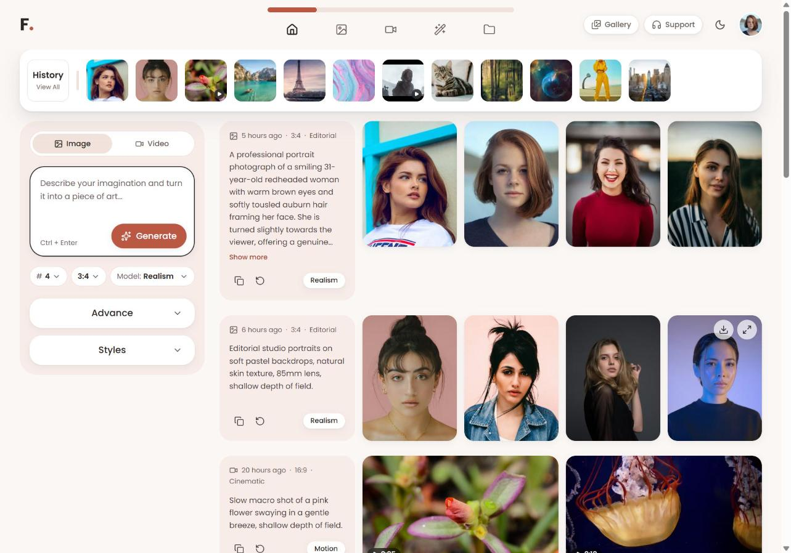
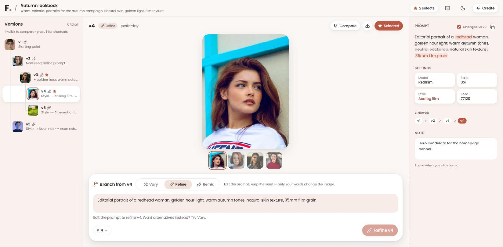

# Fomi — AI Content Generation Workspace

A responsive, production-quality image & video generation workspace for
[Fomi](https://fomi.art), built with Next.js from the assessment mockup.

**Live demo:** [ai-content-generation-xi.vercel.app](https://ai-content-generation-xi.vercel.app/)



The repo contains both parts of the assessment:

- **Part A — Workspace** (`/`): the mockup implemented as a production-quality,
  responsive generation workspace.
- **Part B — Studio** (`/studio`): my redesign of the Image Generation
  workspace. It treats iteration as a version tree you branch, diff and
  compare. See the [Product Thinking document](./docs/product-thinking.md).

---

## Part B — Fomi Studio

**Generation as version control.** Every result is a version with a parent,
the operation that made it and a visible diff.



- **Version tree:** a git-graph-style lineage with thumbnails, one-line
  change summaries, selects (★) and notes.
- **Branch with intent:** **Vary** (new seed), **Refine** (edit words, same
  seed) or **Remix** (new style, model or ratio), with a **live prompt diff**
  before you generate.
- **Compare:** side by side or with a reveal slider, plus the exact prompt
  and settings differences.
- **Keyboard-first:** `J`/`K` to move, `V`/`R`/`X` to branch, `C` to
  compare, `S` to select, `?` for help. Tablet and mobile use drawers.

---

## Part A highlights

- **Generate end-to-end** against a mocked API: pending placeholders shaped
  like the final result, a paced progress bar, cancel, retry and dismiss.
- **Up to 3 generations in parallel** — Generate never locks while one runs.
- **Reuse any past prompt** — one click loads its prompt, model, ratio, style
  and count back into the composer.
- **History strip** that jumps to any generation, paging the feed in if it
  isn't loaded yet (deep links like `/#generation-gen-005` work too).
- **Infinite feed** with a native `<dialog>` lightbox, keyboard paging,
  downloads and silent video previews on hover.
- **Designed per screen size**, not scaled: a thumb-reachable composer bar
  and bottom sheet on mobile, container-query feed rows on tablet/desktop.
- **Light & dark themes**, WCAG AA contrast, full keyboard support and
  reduced-motion support.

## Tech stack

| Area      | Choice                                                         |
| --------- | -------------------------------------------------------------- |
| Framework | Next.js 16 (App Router, Cache Components) — JavaScript         |
| Styling   | Tailwind CSS v4 (design tokens in `globals.css`) + CSS Modules |
| Icons     | lucide-react                                                   |
| Backend   | Mocked with Next.js Route Handlers                             |
| Hosting   | Vercel                                                         |

## Getting started

Requires Node.js 20.9+.

```bash
npm install
npm run dev
```

Open [http://localhost:3000](http://localhost:3000).

| Command         | Description                |
| --------------- | -------------------------- |
| `npm run dev`   | Start the dev server       |
| `npm run build` | Production build           |
| `npm run start` | Serve the production build |
| `npm run lint`  | Lint the codebase          |

### Try it

**Studio** (`/studio`):

- Pick **v4**, press **R**, add a few words and watch the live diff, then
  **Ctrl/⌘ + Enter**. The new version keeps v4's seed.
- Press **C** to compare with the parent, switch to **Slider** and drag (or
  use the arrow keys).
- **Shift-click** any version in the tree to compare against it.

**Workspace** (`/`):

- Type a prompt and press **Generate** (or **Ctrl/⌘ + Enter**).
- Include **`#error`** in a prompt to see the failure and retry flow.
- Press Generate three times quickly to hit the concurrency limit.
- Click any history thumbnail — including old ones — to jump to it.
- Use **Reuse** (↺) on a prompt card, then tweak and regenerate.
- Toggle the theme, then resize to phone width.

## Project structure

```
src/
  app/
    (workspace)/        Routes sharing the header + tools nav
      page.js           Home — all generations (Part A)
      image/, video/    Same workspace, feed filtered by type
      edit/, assets/…   "Coming soon" tools
      error.js          Error boundary for the workspace
    (studio)/studio/    Part B — the branching Studio
    api/
      generations/      GET (paginated feed) · POST (create)
      history/          GET (recent generations)
      studio/           GET project · POST /versions · PATCH /versions/:id
    layout.js           Fonts, theme script, metadata
    not-found.js        Branded 404
    globals.css         Design tokens, themes, base styles
  components/
    ui/                 Primitives: Button, Select, Accordion, Skeleton…
    layout/             Header, tools nav, theme toggle, logo
    workspace/          WorkspaceShell (layout) + WorkspaceProvider (state)
    history/            History strip
    prompt/             Composer: form, mobile bar/sheet, options, styles
    feed/               Feed rows, tiles, pending state, lightbox
    studio/             Version tree, stage, composer, compare, inspector
  config/               Generation options shared by UI and API
  data/                 Mock JSON (media library + seed generations)
  hooks/                Reusable hooks (media query, focus trap, scroll…)
  lib/                  API client, prompt diff, version tree, formatting;
                        server-only mock stores
docs/                   Product Thinking document, screenshot
```

## Architecture & key decisions

**One provider, one reducer.** `WorkspaceProvider` owns everything shared on
a workspace screen — history, feed pages, in-flight jobs, the reuse draft and
screen-reader announcements — so every panel reads one source of truth. New
generations are merged into the feed and history locally instead of
refetching.

**Prompt state stays local.** The composer keeps its own form state so typing
never re-renders the feed. "Reuse" remounts it with a new `key` instead of
syncing state in an effect.

**One form, two layouts.** The same `PromptForm` instance renders as a sticky
sidebar on `md+` and as a bottom sheet on mobile, so nothing is lost on
resize or rotation.

**Container queries for the feed.** Rows react to the feed's own width, not
the viewport: 2 columns when narrow (phones, and tablets beside the panel),
4 when wide, prompt card beside the images from 768px of feed width.

**Config shared by client and server.** `src/config/generation.js` defines
models, ratios, counts and styles; the UI builds its controls from it and the
API validates against it, so they can't drift apart.

**API client boundary.** Components never call `fetch` directly; everything
goes through `src/lib/api.js`, so swapping in the real backend is one file.

**Prompt diff.** `src/lib/diff.js` runs a word-level LCS and merges changes
separated only by whitespace into phrases ("soft window" → "golden hour").
Joining the unchanged and added parts always reproduces the new prompt
exactly. The Studio uses it in the tree, the inspector, the live composer and
compare.

**Native platform first.** `<dialog>` for the lightbox (focus trap, Escape,
inert page), native radio inputs for the style picker, `@starting-style` for
enter animations and CSS-only height animation for accordions.

## Accessibility

- WCAG AA contrast in both themes, with ratios documented next to the tokens.
  The accent is a shade deeper than the mockup's coral, which fails AA (2.4:1)
  with white text.
- Every interaction works by keyboard: skip link, roving focus in the
  segmented control, a full combobox pattern for selects, a focus-trapped
  mobile sheet and lightbox, with focus restored on close.
- Labelled icon buttons, live regions for generation results, `aria-busy`
  on loading regions and semantic landmarks and headings.
- `prefers-reduced-motion` disables CSS animation and JS-driven smooth
  scrolling and video previews.
- Audited with axe-core: no violations on the workspace (light and dark),
  open menus and accordions, the lightbox, `/video`, the 404 page, and the
  Studio (tree, compare, slider, shortcuts dialog, light and dark).

## Performance

- Static prerendering for every page; only the two API routes are dynamic.
- `next/image` with AVIF/WebP, responsive `sizes`, lazy loading below the
  fold and eager, high-priority loading for the first row.
- The lightbox is code-split with `next/dynamic` and loads on first open.
- Feed rows are memoised, so paging in more doesn't re-render existing ones.
- Skeletons match final layouts and tiles reserve their aspect ratio, so
  there's no layout shift as content arrives.

## Mock API

An in-memory backend built with Route Handlers. Responses include artificial
latency so loading states behave like real inference.

| Method | Endpoint           | Description                                                                 |
| ------ | ------------------ | --------------------------------------------------------------------------- |
| `GET`  | `/api/generations` | Paginated feed. Query: `type` (`image` \| `video`), `cursor`, `limit`       |
| `POST` | `/api/generations` | Create a generation. Body: `type, prompt, model, aspectRatio, count, style` |
| `GET`  | `/api/history`     | Recent generations, one cover thumbnail each                                |
| `GET`  | `/api/studio`      | The Studio project with its full version tree                               |
| `POST` | `/api/studio/versions` | Branch a version. Body: `parentId, operation, prompt, model, aspectRatio, style, count` |
| `PATCH`| `/api/studio/versions/:id` | Update `starred`, `heroIndex` or `note`                             |

Errors share one shape: `{ "error": { "code", "message" } }`. Results are
picked by matching prompt keywords to media tags, so _"a cat by the window"_
returns cats.

> **Note:** the store lives in server memory. On Vercel, serverless instances
> don't share memory and reset on cold starts, so new generations may not
> appear after a full page reload. Within a session they're merged into the
> UI locally, so the experience is unaffected.

## Known limitations

- Advanced settings (negative prompt, guidance, seed) are collected and sent
  but ignored by the mock API.
- Edit, Assets, Gallery and Support are placeholder pages.
- The Studio has a single seeded project. Branches are mocked: images are
  picked from the library by prompt keywords, and Refine's kept seed is
  recorded but can't truly constrain a mock.
- Some sample videos are hosted without CORS headers, so "Download" opens
  them in a new tab instead of saving directly.

## Credits

Images from [Unsplash](https://unsplash.com). Sample videos from MDN (CC0),
and _Sintel_ and _Big Buck Bunny_ © Blender Foundation (CC BY 3.0) via
test-videos.co.uk.
